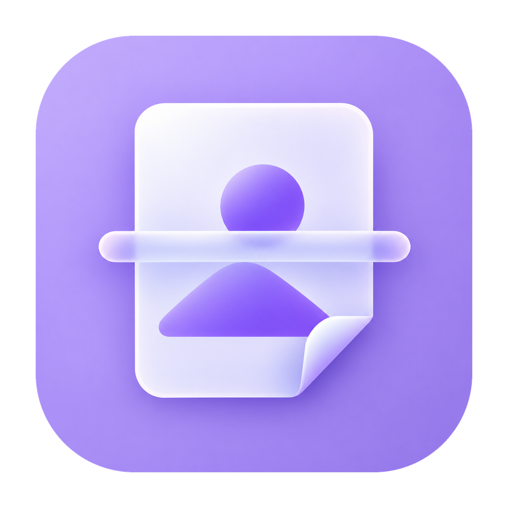
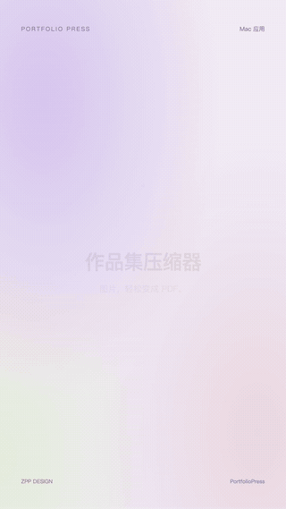

<p align="center">
  
</p>

# PortfolioPress · 作品集压缩器

把图片或整个文件夹拖进来，生成适合投递的 PDF。原始像素尺寸不变，压缩体积按目标自动调整。

我做这个小工具，是因为作品集太大，投递时经常遇到文件大小限制。借助 AI，从需求、开发到界面设计，做出了自己每天能用的 Mac 应用。现在把它开源，希望也能帮到有同样需求的人。

**[下载 Mac 版](https://github.com/veleszhang/portfolio-press/releases/latest) · [观看完整宣传视频](docs/demo.mp4) · [反馈问题](https://github.com/veleszhang/portfolio-press/issues)**

## 视频预览

<p align="center">
  <a href="docs/demo.mp4"></a>
</p>

上方为动图预览，点击可进入完整 MP4 文件；如 GitHub 页面未直接播放，可下载观看。公开视频使用重新渲染的打码画面，主预览与侧栏缩略图中的手机号均采用不透明遮挡，保留宣发视频声音。

## 能做什么

- 批量导入图片，或拖入整个文件夹，自动收集子文件夹中的图片。
- 按路径及文件名自然排序，也可以拖动卡片或用按钮调整页序。
- 目标体积可选 5 / 10 / 15 / 20 / 30 MB，默认 **15 MB + 均衡**。
- 三档压缩：清晰优先、均衡、小文件优先。根据实际 PDF 大小寻找合适参数。
- 保持原始像素尺寸，RGB 图片保留 sRGB / Display P3 等 ICC 色彩配置。
- 对比原图和生成后的 PDF，导出 PDF 或压缩后的 JPG。
- 本地离线处理，不上传图片，不覆盖原文件，自动记住压缩设置。

演示中真实测试：**69 页，24.83 MB 原始图片 → 14.76 MB PDF**。实际体积取决于图片内容和选择的档位。

## 使用

1. 从 [Releases](https://github.com/veleszhang/portfolio-press/releases/latest) 下载 ZIP 并解压。
2. 打开“作品集压缩器.app”，也可以将它拖入“应用程序”。
3. 拖入图片文件夹，检查页序，点击“生成 PDF”。
4. 放大检查小字与细节，再导出。

当前预编译版本适用于 **Apple Silicon Mac、macOS 14 或更高版本**，采用临时签名，未做 Apple 公证。首次打开可能被 Gatekeeper 拦截；请遵循 macOS 的应用打开流程，或自行从源码构建。

支持 **PNG、JPG/JPEG、HEIC/HEIF、TIFF、WebP**。暂不支持直接导入 PDF。

## 关于画质

这是**保留原尺寸的有损压缩**，不等于像素级无损。

图片会编码为 JPEG，再嵌入 PDF。工具不降低像素尺寸，但 JPEG 编码可能改变细微色值、纹理、细线和小字。每张 RGB 图片的 ICC 配置都会匹配地嵌入 JPEG 和 PDF；灰度、CMYK 或缺少有效 RGB 配置的图片会转换或回退到 sRGB。

透明区域铺白底。输出为图片型 PDF，不保留可选中文字、矢量图或链接。当质量下限仍无法满足目标体积时，会提示超标并允许导出，不强行缩图。方向标记会转换为正向，可能交换宽高，像素总量不变。MB 采用十进制：1 MB = 1,000,000 字节。

## 从源码构建

原生 SwiftUI + AppKit + ImageIO + PDFKit，无第三方运行时依赖。

安装 Xcode Command Line Tools 或 Xcode 后：

```bash
git clone https://github.com/veleszhang/portfolio-press.git
cd portfolio-press
./test.sh
./build.sh
open dist/作品集压缩器.app
```

脚本使用本机架构构建，输出 `.app` 和 ZIP 到 `dist/`。Intel 构建路径保留，但目前只在 Apple Silicon 上进行过本地验证。

## 参与贡献

欢迎提 Issue 或 PR，尤其是批量导入体验、压缩效率、色彩管理、键盘操作与可访问性方面的改进。

反馈问题时请附 macOS 版本、应用版本和复现步骤。示例图片请先去除个人信息，不要上传私人简历或作品集原文件。

## 许可

代码与应用图标采用 [MIT License](LICENSE)。宣传视频及其中的作品集、人物、品牌画面不属于 MIT 授权范围，保留各自权利；提供视频仅用于展示本项目。

作者：**张彭彭 / Veles / ZPP** · [zppdesign.com](https://zppdesign.com)
